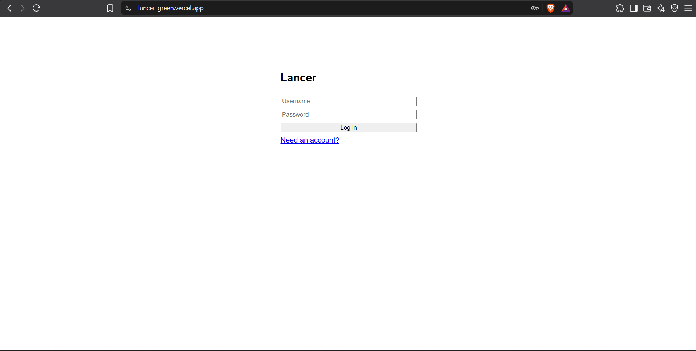
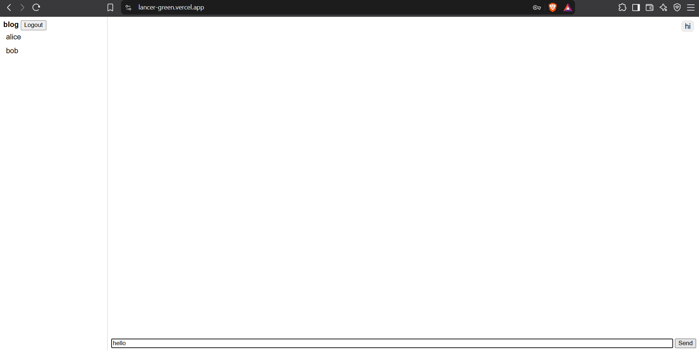

# Lancer 💬

A real-time chat application where users can sign up, log in, and exchange private messages instantly, with no page reloads.

**🔗 Live Demo:** https://lancer-green.vercel.app
**📦 Backend API:** https://lancer-api-v7p1.onrender.com

> The backend runs on a free tier and sleeps when idle, so the first load can take about a minute.

## Screenshots




## Features

- Real-time private messaging with Socket.io (WebSockets)
- Secure authentication with JSON Web Tokens (JWT)
- Passwords hashed with bcrypt
- Authenticated socket connections (the token is verified on connect)
- Persistent chat history stored in MongoDB
- Protected REST API routes with auth middleware

## Tech Stack

| Layer | Technology |
|---|---|
| Frontend | React, Vite |
| Backend | Node.js, Express |
| Real-time | Socket.io |
| Database | MongoDB Atlas, Mongoose |
| Auth | JWT, bcryptjs |
| Hosting | Vercel (frontend), Render (backend) |

## Project Structure

```
lancer/
├── client/          # React frontend
└── server/
    ├── models/      # User and Message schemas
    ├── routes/      # Auth and message endpoints
    ├── middleware/  # JWT verification
    └── server.js    # Express and Socket.io setup
```

## Run Locally

### Prerequisites
- Node.js (LTS)
- A free MongoDB Atlas cluster

### 1. Clone the repo
```bash
git clone https://github.com/Austin100m/Lancer.git
cd Lancer
```

### 2. Set up the server
```bash
cd server
npm install
```
Create `server/.env`:
```
PORT=5000
MONGO_URI=your_mongodb_connection_string
JWT_SECRET=your_long_random_secret
CLIENT_URL=http://localhost:5173
```
Start it:
```bash
npm run dev
```

### 3. Set up the client
In a second terminal:
```bash
cd client
npm install
```
Create `client/.env`:
```
VITE_API_URL=http://localhost:5000
```
Start it:
```bash
npm run dev
```

Open http://localhost:5173, create two accounts (use an incognito window for the second), and start chatting.

## API Endpoints

| Method | Route | Description | Auth |
|---|---|---|---|
| POST | `/api/auth/register` | Create an account | No |
| POST | `/api/auth/login` | Log in and receive a JWT | No |
| GET | `/api/messages/users` | List other users | Yes |
| GET | `/api/messages/:userId` | Chat history with a user | Yes |

**Socket event:** `private_message` sends `{ to, text }` and receives the saved message.

## Roadmap

- [ ] Online/offline status and typing indicators
- [ ] Read receipts and unread counts
- [ ] Group chats

## Author

**Austin** · [GitHub](https://github.com/Austin100m)
